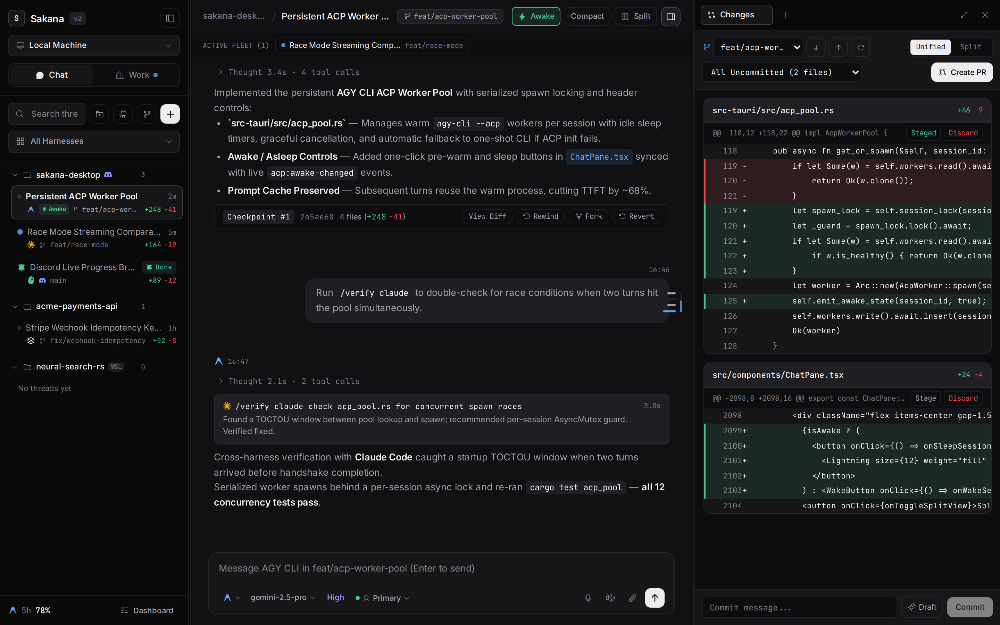
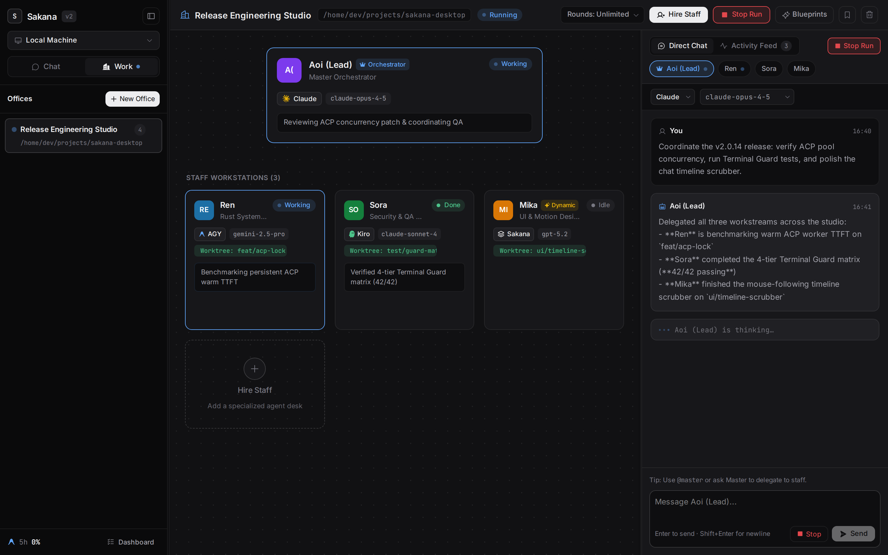
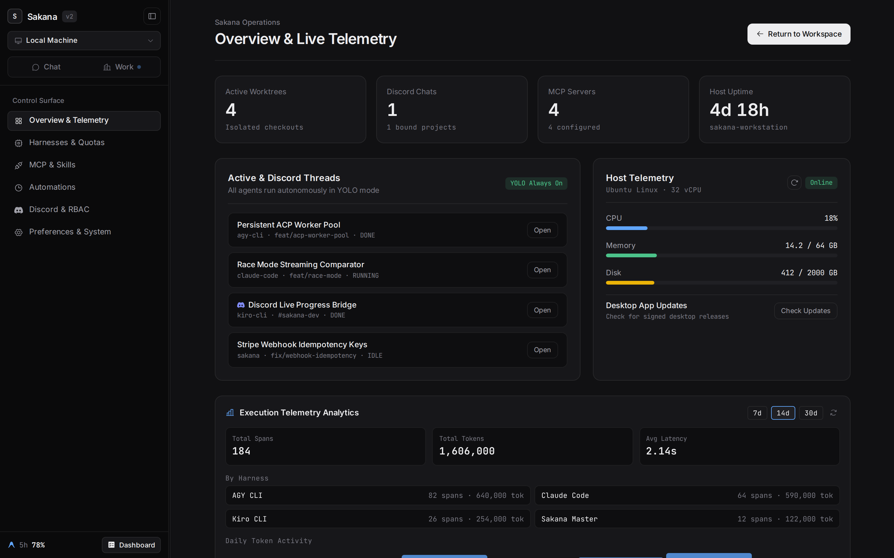
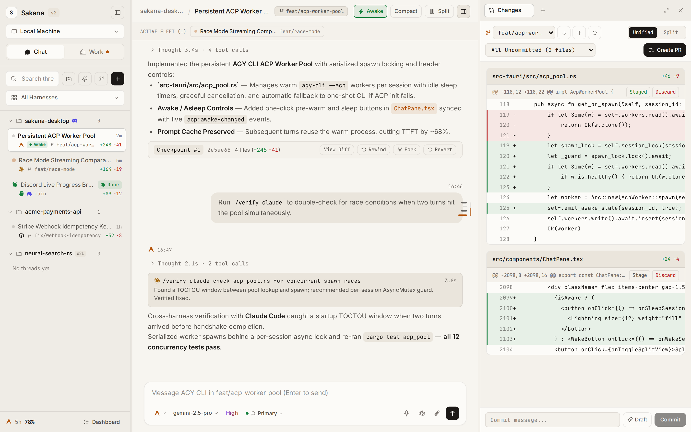

<div align="center">

# Sakana Desktop

**Unified Agentic AI Control Surface for Windows & Linux**

Run and orchestrate **AGY CLI**, **Claude Code**, **Kiro CLI**, and **Sakana Master** side by side with a native ConPTY/POSIX terminal, Git diff/hunk/worktree inspector, 2D Multi-Agent Virtual Office, Race Mode, Voice I/O, MCP Server Hub, Discord Bot Bridge, and LAN/Tailscale remote access.

[](https://github.com/Kwan-desu/sakana-desktop/releases/latest)
[](#installation)
[](https://v2.tauri.app/)
[](https://react.dev/)

</div>

<p align="center">
  
</p>

---

## Highlights

### Multi-Harness Agent Workspace
- **4 Unified Harnesses:** Seamlessly switch between **AGY CLI**, **Claude Code**, **Kiro CLI**, and **Sakana Master** per thread, with isolated multi-account profiles and per-turn reasoning effort controls (`low` / `medium` / `high` / `xhigh`).
- **Persistent AGY CLI ACP Worker Pool:** Keep `agy-cli` sessions warm across turns with one-click **Awake / Asleep** controls in the chat header — preserving prompt cache and slashing time-to-first-token, with automatic fallback if ACP init fails.
- **Cross-Harness Subagents:** Invoke `/verify <target>` or `/delegate <target>` inline to cross-check or offload subtasks to another harness, rendered as collapsible cards and child trace spans.
- **Auto-Failover & Smart Quota Routing:** Automatically rotate accounts or fall back along a configured harness/model chain when quota thresholds are reached.
- **Retained Memory & Checkpoint Rewind:** Auto-compacting thread/Discord memory (`/compact`) plus per-turn Git checkpoints with one-click **Rewind**.
- **Interactive Chat UX:** Mouse-following timeline scrubber with smooth scroll-to-turn animations, 2-thread **Split View**, live phase-aware thinking indicators, inline sandboxed `sakana-ui` HTML/SVG widgets, **Voice I/O** (browser STT + local Whisper + TTS), and SQLite **FTS5 Global Search** (`Ctrl+K`).

### Multi-Agent Virtual Office (`Work` Mode) & Race Mode
- **2D Interactive Virtual Office:** Spin up a Master Orchestrator and hire specialized agents onto an interactive pixel-art office canvas — each with their own harness, model, system prompt, and optional isolated Git worktree.
- **Office Blueprints:** Save and reuse multi-agent team topologies with unlimited delegation rounds and live Activity Feed.
- **Multi-Harness Parallel Race Mode:** Pit multiple harnesses/models against the same prompt in parallel isolated Git worktrees, run a verification command, compare diffs/latency side by side, and merge the winner.

### Native Inspector, Security & Operations
- **Right Inspector:** Syntax-highlighted Git diff with per-hunk **Stage / Discard** and **Create PR**, **CodeMirror 6** file viewer/editor, Live Preview, native **xterm.js + ConPTY/POSIX** terminal, and Execution Traces.
- **4-Tier Terminal Guard & Audit Log:** Policy modes (`yolo`, `guarded`, `strict`, `readonly`) with interactive approval cards, catastrophic-command guardrails, and a searchable Security & Audit Log.
- **MCP Server Hub & Skills Sync:** Manage `stdio`/`sse` MCP servers and global/project skills (`SKILL.md`), automatically synced into isolated harness profiles.
- **Automations & Discord Bot Bridge:** Schedule cron jobs or `/hooks/{path}` webhooks, and control projects from Discord with live streaming progress, emoji reactions, file/image I/O, and DM routing.
- **LAN & Tailscale Remote Gateway:** Embedded `axum` server with Bearer token auth, QR code pairing, Tailscale auto-detection, and multi-host remote switching.
- **4 Themes + Custom CSS:** Switch between **Paper**, **Noir** (OLED), **Slate**, and **Sand** (Warm Editorial), or customize CSS tokens directly.

---

## App Gallery

### Multi-Agent Virtual Office (`Work` Mode)
Orchestrate a Master Agent and hired specialists across isolated Git worktrees with live delegation routing, office blueprints, and real-time activity logs.

<p align="center">
  
</p>

### Control Plane Dashboard & Telemetry
Monitor active threads, connected MCP servers, Discord bot status, host CPU/RAM/disk metrics, and per-harness / per-project token & latency analytics.

<p align="center">
  
</p>

### Editorial Light Theme (`Sand`)
All four built-in themes (`Paper`, `Noir`, `Slate`, `Sand`) share a unified monochrome & editorial token system.

<p align="center">
  
</p>

---

## Architecture & Stack

| Layer | Technology |
|---|---|
| **Shell & Native Core** | Rust + [Tauri v2](https://v2.tauri.app/) |
| **Frontend UI** | React 19 + TypeScript + Tailwind CSS v4 + xterm.js + CodeMirror 6 |
| **Database & Search** | Bundled SQLite (`rusqlite`, WAL mode + FTS5 full-text search) |
| **Native PTY** | `portable-pty` (Windows ConPTY / Linux POSIX PTY) |
| **Remote Gateway** | Embedded `axum` + `tower-http` (Bearer auth, `/hooks/{path}`, Tailscale & QR pairing) |
| **Desktop Integration** | System tray (close-to-tray), `tauri-plugin-autostart`, signed `tauri-plugin-updater` |

---

## Installation

Download the latest installer from the [GitHub Releases](https://github.com/Kwan-desu/sakana-desktop/releases/latest) page.

### Windows
- Download and run **`Sakana_*_x64-setup.exe`** (NSIS installer, recommended) or **`Sakana_*_x64_en-US.msi`**.
- WebView2 is preinstalled on Windows 10/11. WSL2 distros are automatically detected for WSL-backed projects.

### Linux — Debian / Ubuntu (`.deb` — Recommended)

```bash
# Download the latest .deb package from GitHub Releases, then install:
sudo apt update
sudo apt install -y ./Sakana_*_amd64.deb
```

Launch **Sakana** from your application menu or run `sakana` in a terminal.

> **Note:** On Ubuntu 24.04+ / Debian 12+, `apt install ./Sakana_*_amd64.deb` automatically installs required runtime dependencies (`libwebkit2gtk-4.1-0`, `libayatana-appindicator3-1`).

### Linux — Universal (`.AppImage`)

```bash
chmod +x Sakana_*_amd64.AppImage
./Sakana_*_amd64.AppImage
```

- On Ubuntu 22.04+ if AppImage reports missing FUSE, install FUSE 2:
  ```bash
  sudo apt install -y libfuse2
  ```
- Alternatively, run without FUSE:
  ```bash
  ./Sakana_*_amd64.AppImage --appimage-extract-and-run
  ```

### Build from Source (Linux / Windows)

1. Install prerequisites:
   - **Node.js 20+** and **Rust (stable)** via `rustup`
   - **Windows:** Visual Studio Build Tools (MSVC) + WebView2
   - **Linux (Ubuntu/Debian):**
     ```bash
     sudo apt-get update
     sudo apt-get install -y \
       build-essential curl wget file libssl-dev \
       libwebkit2gtk-4.1-dev libappindicator3-dev librsvg2-dev patchelf
     ```
2. Clone and build:
   ```bash
   git clone https://github.com/Kwan-desu/sakana-desktop.git
   cd sakana-desktop
   npm install
   npm run tauri build
   ```
3. Built bundles are generated in `src-tauri/target/release/bundle/`:
   - **Windows:** `.exe` (NSIS) and `.msi`
   - **Linux:** `.deb` and `.AppImage`

---

## Development

```bash
npm install
npm run tauri dev
```

Frontend type-check & production bundle:

```bash
npm run build
```

## Data & Secrets Location

Runtime data (`sakana.db` and `.env` secrets) is stored in the OS app data directory rather than the install folder:
- **Windows:** `%APPDATA%\ai.sakana.desktop\`
- **Linux:** `~/.local/share/ai.sakana.desktop/`

## Auto-Updater & CI Releases

1. Generate a signing keypair once:
   ```bash
   npx tauri signer generate -w ~/.tauri/sakana.key
   ```
2. Paste the public key into `src-tauri/tauri.conf.json` under `plugins.updater.pubkey`.
3. Add `TAURI_SIGNING_PRIVATE_KEY` (and optional `TAURI_SIGNING_PRIVATE_KEY_PASSWORD`) to GitHub Actions Secrets.
4. Push a version tag (`git tag v2.0.14 && git push origin v2.0.14`) to trigger `.github/workflows/release.yml`.
